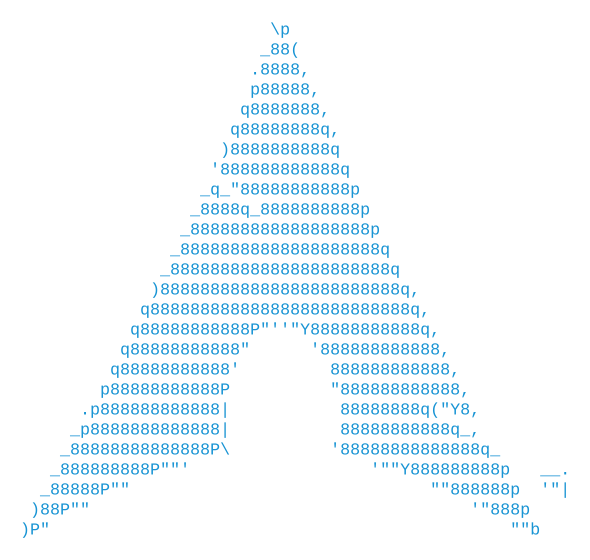
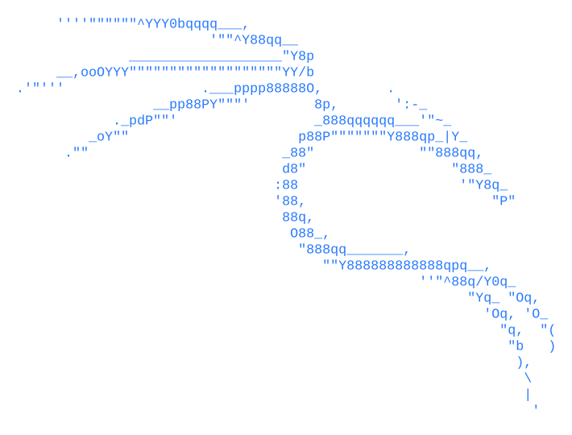
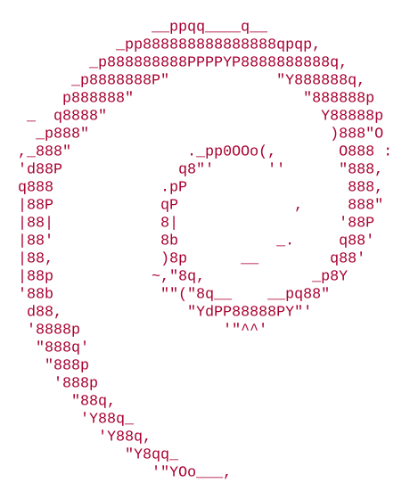
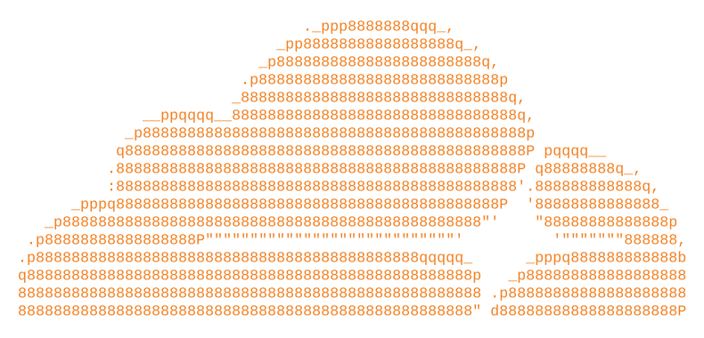
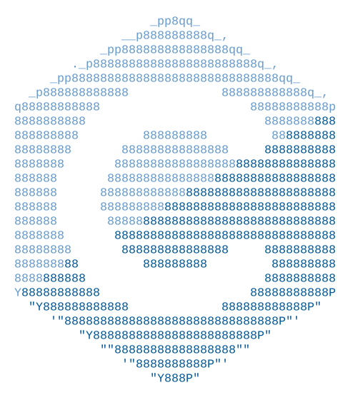
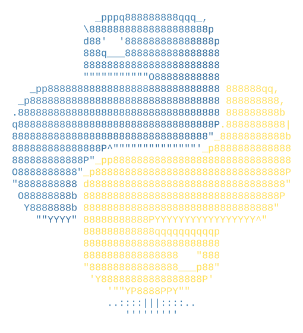
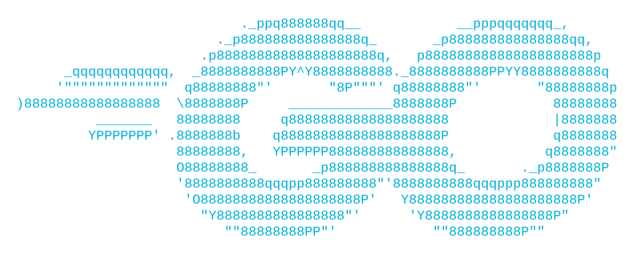
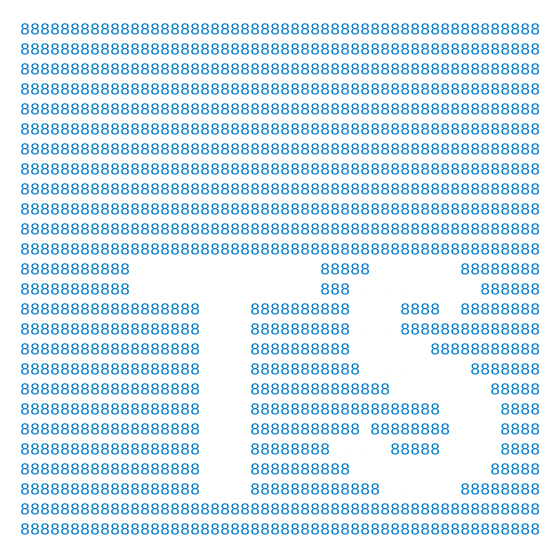

  <picture>
    <source media="(prefers-color-scheme: dark)" srcset="https://ascii.rest/banner/Y0KONAD.dark.svg?color=22d3ee,4493f8&effect=glint&tagline=Software%20Developer%20%7C%20Cybersecurity%20%26%20Networking&art=arch-linux">
    
  </picture>

  Focused on distributed web platforms, network architecture, and systems security. 
  Based in Peru, developing primarily on Arch Linux.

  

### Technical Stack

  <picture>
    <source media="(prefers-color-scheme: dark)" srcset=".github/assets/stack/arch-linux.dark.svg">
    
  </picture>
  &nbsp;&nbsp;
  <picture>
    <source media="(prefers-color-scheme: dark)" srcset=".github/assets/stack/kali-linux.dark.svg">
    
  </picture>
  &nbsp;&nbsp;
  <picture>
    <source media="(prefers-color-scheme: dark)" srcset=".github/assets/stack/debian.dark.svg">
    
  </picture>
  &nbsp;&nbsp;
  <picture>
    <source media="(prefers-color-scheme: dark)" srcset=".github/assets/stack/cloudflare.dark.svg">
    
  </picture>

  <picture>
    <source media="(prefers-color-scheme: dark)" srcset=".github/assets/stack/c.dark.svg">
    
  </picture>
  &nbsp;&nbsp;
  <picture>
    <source media="(prefers-color-scheme: dark)" srcset=".github/assets/stack/python.dark.svg">
    
  </picture>
  &nbsp;&nbsp;
  <picture>
    <source media="(prefers-color-scheme: dark)" srcset=".github/assets/stack/go.dark.svg">
    
  </picture>
  &nbsp;&nbsp;
  <picture>
    <source media="(prefers-color-scheme: dark)" srcset=".github/assets/stack/typescript.dark.svg">
    
  </picture>

### Networking & Security Specialization

- **Routing & Switching:** Cisco IOS, VLSM Subnet Planning, Cisco Packet Tracer, Network Topology Design
- **Traffic & Packet Analysis:** Wireshark, TCP/IP Protocol Suite, OSI Architecture, Network Reconnaissance
- **Security Assessment:** Kali Linux, Nmap Port Scanning, Automated Vulnerability Assessment

### Featured Repositories

- [**mcp-gemini-packet**](https://github.com/y0konad/mcp-gemini-packet) — Model Context Protocol bridge connecting Gemini with Cisco Packet Tracer for network topology design.
- [**subneteo-vlsm**](https://github.com/y0konad/subneteo-vlsm) — Automated IPv4 VLSM calculator and network subnet allocation engine.
- [**yokonad.github.io**](https://github.com/y0konad/yokonad.github.io) — Personal engineering portal and web portfolio built with Astro and Tailwind CSS.
- [**calculadora-resistencias**](https://github.com/y0konad/calculadora-resistencias) — Electronic resistor color-code decoding utility with tolerance and thermal coefficient calculation.

### GitHub Activity

  
  

